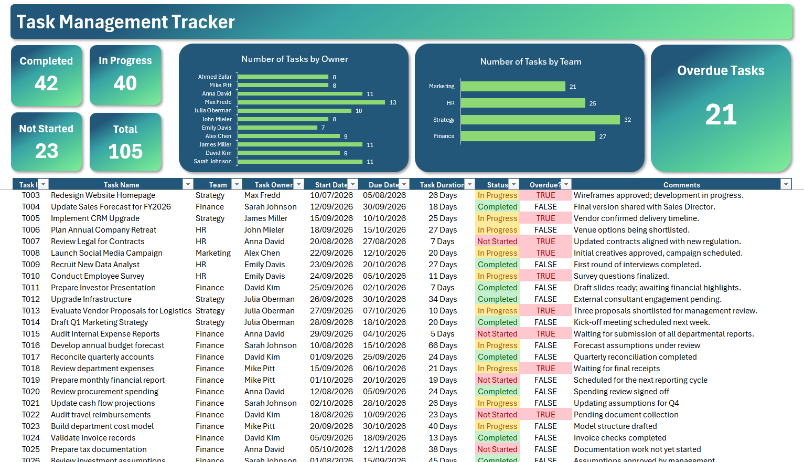

# 📊 Excel Task Management Dashboard

> An interactive Excel-based task management tracker designed to organize tasks, enforce consistent data entry, automatically calculate task metrics, and provide a clear management dashboard for monitoring progress and overdue work.


---

## 📌 Project Overview

The **Task Management Dashboard** is an Excel reporting and tracking solution that transforms a structured task list into an interactive management dashboard.

The workbook allows users to:

- Define and maintain tasks in a structured Excel Table
- Assign tasks to owners and teams
- Track task start and due dates
- Monitor task status
- Automatically calculate task duration
- Automatically identify overdue tasks
- Restrict key input fields through Excel Data Validation
- Aggregate task information through a dedicated support sheet
- Monitor KPIs for overall task progress
- Analyze workload by owner and team through charts

The main goal of the project was to create a **clean, controlled, and easy-to-maintain task tracking system** where updating the task table automatically updates the underlying calculations and dashboard.

---

## 🎯 Business Problem

Task tracking can quickly become difficult when information is maintained manually across spreadsheets.

Common issues include:

- Inconsistent status or team names
- Incorrect task ownership entries
- Manual calculation of task duration
- Difficulty identifying overdue tasks
- Time-consuming reporting and status summaries
- Limited visibility into workload distribution

This project addresses these issues by combining **structured Excel data, formulas, validation rules, summary calculations, KPIs, and visual reporting** into one workbook.

---
## 📊 Dataset

The dataset contains **105 tasks** from **10 July 2026 to 30 November 2026**, covering typical business activities such as financial reporting, market research, recruitment and marketing campaigns.

| Column | Description | Type |
|---|---|---|
| `Task ID` | Unique task identifier (T001 to T105) | Text |
| `Task Name` | Short description of the task | Text |
| `Team` | Finance, Strategy, HR or Marketing | Dropdown |
| `Task Owner` | Person responsible for the task (11 owners) | Dropdown |
| `Start Date` | Planned start date | Date |
| `Due Date` | Deadline | Date |
| `Task Duration` | Days between start and due date | Calculated |
| `Status` | Not Started, In Progress or Completed | Dropdown |
| `Overdue?` | `TRUE` if the task is not completed and past its due date | Calculated |
| `Comments` | Free-text progress notes | Text |

> **Note:** The data is sample data created for demonstration purposes.


---
## 🏗️ Workbook Architecture

The workbook is organized into two main layers:

```text
┌──────────────────────────────────────────────┐
│              Dashboard Sheet                │
│                                              │
│  KPIs → Task Status → Overdue Monitoring    │
│  Owner Chart → Team Chart                   │
└──────────────────────▲───────────────────────┘
                       │
                       │ Calculated summaries
                       │
┌──────────────────────┴───────────────────────┐
│              Support Sheet                  │
│                                              │
│  Status Counts   Owner Counts   Team Counts │
│  Overdue Count                              │
└──────────────────────▲───────────────────────┘
                       │
                       │ COUNTIF / references
                       │
┌──────────────────────┴───────────────────────┐
│             Task Management Table           │
│                                              │
│ ID | Task | Team | Owner | Dates | Status  │
│ Duration | Overdue | Comments               │
└──────────────────────────────────────────────┘
```

### Workbook sheets

| Sheet | Purpose |
|---|---|
| **Dashboard** | Main user-facing dashboard containing KPIs, task data, and visual analysis |
| **Support Sheet** | Calculation layer used to generate status, owner, team, and overdue summaries |

---

## ⚙️ Key Features

### 1. Structured Excel Table

The task dataset is stored as an Excel Table (`Table1`), allowing formulas and references to remain structured as the task list is maintained.

The table contains fields such as:

- Task ID
- Task Name
- Team
- Task Owner
- Start Date
- Due Date
- Task Duration
- Status
- Overdue?
- Comments

Using an Excel Table also makes the dataset easier to maintain and allows structured references to be used throughout the workbook.

---

### 2. Automated Task Duration

Task duration is calculated automatically from the start and due dates.

The workbook uses a structured-reference formula equivalent to:

```excel
=[@[Due Date]]-[@[Start Date]]
```

This removes the need for users to manually calculate the duration of each task.

---

### 3. Automated Overdue Detection

The workbook automatically identifies tasks that are overdue using the task status and due date.

The logic is:

```excel
=AND(
    [@[Status]]<>"Completed",
    [@[Due Date]]<TODAY()
)
```

This means a task is considered overdue when:

1. It is **not completed**, and
2. Its due date is earlier than today's date.

Because the calculation uses `TODAY()`, the overdue status updates automatically as time passes.

---

### 4. Data Validation

To improve data quality and prevent inconsistent entries, dropdown-based Excel Data Validation is applied to key fields.

#### Task Owner

Users can select only from the defined owner list.

#### Team

Users can select only from the defined team list.

#### Status

Users can select only from the predefined statuses:

- Completed
- In Progress
- Not Started

This creates a controlled data-entry environment and makes downstream reporting more reliable.

---

## 📈 Support Sheet & Calculations

The **Support Sheet** acts as the calculation layer behind the dashboard.

It summarizes:

### Task Status

The workbook calculates the number of tasks for each status using `COUNTIF`.

Example:

```excel
=COUNTIF(Table1[Status],B3)
```

### Task Owners

The number of tasks assigned to each owner is calculated using:

```excel
=COUNTIF(Table1[Task Owner],E3)
```

### Teams

The number of tasks assigned to each team is calculated using:

```excel
=COUNTIF(Table1[Team],H3)
```

### Overdue Tasks

The total number of overdue tasks is calculated from the automated `Overdue?` field:

```excel
=COUNTIF(Table1[Overdue?],TRUE)
```

This separation between the **input data** and **calculation layer** keeps the dashboard logic organized and easier to maintain.

---

## 📊 Dashboard KPIs

The dashboard provides a high-level view of task progress through key indicators:

| KPI | Description |
|---|---|
| **Completed** | Number of completed tasks |
| **In Progress** | Number of currently active tasks |
| **Not Started** | Number of tasks that have not yet started |
| **Total** | Total number of tracked tasks |
| **Overdue Tasks** | Number of incomplete tasks past their due date |

The expanded sample dataset contains **105 tasks (T001–T105)**. In the uploaded workbook, the task statuses are distributed as follows:

| Status | Tasks |
|---|---:|
| Completed | 42 |
| In Progress | 40 |
| Not Started | 23 |
| **Total** | **105** |

As of **October 10, 2026**, the dataset contains **13 overdue tasks** under the workbook's rule (not completed and due date earlier than today). This count changes automatically over time because the overdue formula uses `TODAY()`.

---

### Current Sample Dataset

The expanded workbook contains 105 task records. The task distribution by team and owner is:

| Team | Tasks |
|---|---:|
| Strategy | 32 |
| Finance | 27 |
| HR | 25 |
| Marketing | 21 |

| Task Owner | Tasks |
|---|---:|
| Sarah Johnson | 25 |
| David Kim | 21 |
| Emily Davis | 21 |
| Alex Chen | 20 |
| James Miller | 18 |

## 📊 Visualizations

The dashboard includes two main charts:

### Tasks by Owner

A bar chart showing the number of tasks assigned to each task owner.

This provides a quick view of workload distribution and can help identify owners with relatively high or low task volumes.

### Tasks by Team

A bar chart showing the number of tasks assigned to each team.

This makes it easier to understand how the overall workload is distributed across organizational teams.

---

## 🔄 How the Dashboard Works

The workflow is designed to be simple:

```text
1. Enter / update task information
              ↓
2. Excel Table stores structured task data
              ↓
3. Formulas calculate duration & overdue status
              ↓
4. Data validation keeps inputs consistent
              ↓
5. Support Sheet aggregates task metrics
              ↓
6. Dashboard KPIs and charts reflect the data
```

The user mainly interacts with the task table. The calculation and reporting layers handle the rest.

---

## 🛠️ Tools & Skills Demonstrated

### Tools

- **Microsoft Excel**
- Excel Tables
- Excel Formulas
- Data Validation
- Conditional Formatting
- Charts & Dashboard Design

### Excel Functions & Techniques

- `COUNTIF`
- `SUM`
- `AND`
- `TODAY`
- Structured References
- Excel Table references
- List-based Data Validation
- KPI design
- Dashboard reporting
- Data aggregation

### Data / Analytics Skills

- Data organization
- Data quality control
- Automated calculations
- KPI development
- Workload analysis
- Dashboard design
- Business reporting

---

## 📁 Project Structure

```text
Task-Management-Tracker/
│
├── 📊 Task_Management_Tracker.xlsx
└── 📄 README.md
```

---

## 🚀 How to Use

1. Download or clone the repository.
2. Open `Task_Management_Tracker.xlsx` in Microsoft Excel.
3. Go to the **Dashboard** sheet.
4. Add or modify tasks in the task table.
5. Use the dropdown lists for:
   - Team
   - Task Owner
   - Status
6. Enter the start and due dates.
7. Review the automatically calculated:
   - Task Duration
   - Overdue status
8. Review the updated KPIs and charts on the dashboard.

> **Note:** The workbook is designed for Microsoft Excel. Some Excel-specific features, particularly Data Validation and structured table behavior, may not behave identically in other spreadsheet applications.

---

## 💡 Design Principles

This project was built around four principles:

**1. Data Quality**  
Controlled input values reduce inconsistent entries and improve reporting reliability.

**2. Automation**  
Calculated fields eliminate repetitive manual calculations.

**3. Separation of Logic and Presentation**  
The Support Sheet provides a dedicated calculation layer, while the Dashboard focuses on reporting and visualization.

**4. Usability**  
The user interacts primarily with the task table while the dashboard provides an immediate management-level summary.

---

## 🔮 Potential Future Improvements

The current version provides a solid task tracking and reporting foundation. Potential enhancements could include:

- 📅 Timeline / Gantt chart for task planning
- 📈 Completion-rate and productivity trends over time
- 🔎 Interactive filters or slicers
- 🚦 Priority and risk indicators
- 👤 Owner-specific workload dashboards
- 📆 Monthly / weekly task trend analysis
- ⏱️ Average task duration KPI
- 📉 Overdue-task trend tracking
- 🔄 Power Query integration for external data sources
- 🤖 Power Automate integration for automated notifications
- 📊 More advanced dashboard interactivity

---

## 🧠 What I Learned

This project provided practical experience in building an Excel-based reporting solution from the ground up.

Key takeaways include:

- Designing structured datasets for reporting
- Using Excel Tables and structured references
- Building formula-driven calculated fields
- Implementing data validation for data quality
- Separating calculation logic from dashboard presentation
- Designing meaningful KPIs
- Turning raw operational data into management-level insights
- Creating dashboards that are both functional and easy to maintain

---

## 👤 Project Purpose

This project was developed as a practical demonstration of **Excel data analysis, dashboard development, data validation, formula automation, and business reporting**.

It showcases how Excel can be used not only for storing data, but also as a lightweight **task management and business intelligence solution**.

---

## ⭐ If You Find This Project Useful

Feel free to explore the workbook, adapt the structure to your own task-tracking use case, or use the approach as a starting point for building more advanced Excel dashboards.
